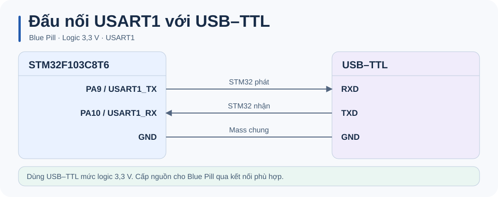
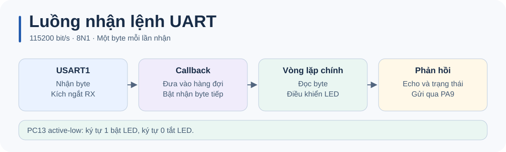

# STM32 UART · Điều khiển LED qua terminal

Demo **USART1 trên STM32F103C8T6 (Blue Pill)**. Gửi `1` để bật LED PC13, `0` để tắt. Firmware echo ký tự và gửi trạng thái để có thể kiểm tra cả hai chiều UART.



## Đấu dây

| Blue Pill | USB–TTL | Vai trò |
| --- | --- | --- |
| PA9 | RXD | USART1 TX |
| PA10 | TXD | USART1 RX |
| GND | GND | Mass chung |

Dùng adapter USB–TTL mức logic 3,3 V. Cấp nguồn cho Blue Pill riêng phù hợp với board.

## Build và nạp firmware

Cần **Python 3.9+**, **GNU Arm Embedded** (`arm-none-eabi-gcc`, `objcopy`, `size`) và gói **STM32CubeF1 v1.8.7**. Script dùng HAL và startup từ gói ST, cùng linker script 64 KiB flash / 20 KiB SRAM của STM32F103C8.

```sh
python build.py
```

Đặt GNU Arm Embedded vào `PATH`, hoặc chỉ định thư mục `bin` của toolchain. Nếu gói HAL nằm ngoài thư mục mặc định `~/STM32Cube/Repository/STM32Cube_FW_F1_V1.8.7`, truyền đường dẫn tới thư mục chứa `Drivers`.

```sh
python build.py --sdk "<STM32CubeF1 root>" --toolchain "<GNU Arm bin>"
```

Build tạo `build/firmware.elf`, `build/firmware.hex` và `build/firmware.bin`. Nạp `.hex` bằng STM32CubeProgrammer qua ST-LINK/SWD, rồi reset board. Có thể dùng `.elf` để nạp symbol và debug. Firmware mẫu dùng HSE 8 MHz và SYSCLK 72 MHz.

Tài liệu công cụ: [STM32CubeF1](https://github.com/STMicroelectronics/STM32CubeF1) · [STM32CubeProgrammer](https://www.st.com/en/development-tools/stm32cubeprog.html).

## Chạy thử

1. Mở cổng serial của USB–TTL ở **115200 bit/s, 8 data bit, no parity, 1 stop bit**, tắt flow control.
2. Mở terminal trước khi reset board để thấy chuỗi `So: 1` đến `So: 30` và `Done!`.
3. Gửi `1` và kiểm tra LED sáng cùng phản hồi `1 -> LED ON!`. Gửi `0` và kiểm tra LED tắt. Phản hồi kèm bộ đếm lệnh.



## Mã nguồn và chẩn đoán

- [Ứng dụng USART1](Core/Src/main.c) xử lý lệnh, echo và cập nhật LED trong vòng lặp chính.
- [Hướng dẫn HAL](docs/CODE_GUIDE.md) giải thích callback, hàng đợi, cấu hình CubeMX và cách debug.
- [Board support](firmware/board.c) cấu hình GPIO, USART1 IRQ và SysTick cho build độc lập.

Không thấy phản hồi thì kiểm tra đúng cổng, dây TX/RX đấu chéo, GND chung và baud rate. Nếu mất dữ liệu khi gửi liên tục, xem `debug_rx_dropped` hoặc gửi lệnh với nhịp chậm hơn.
