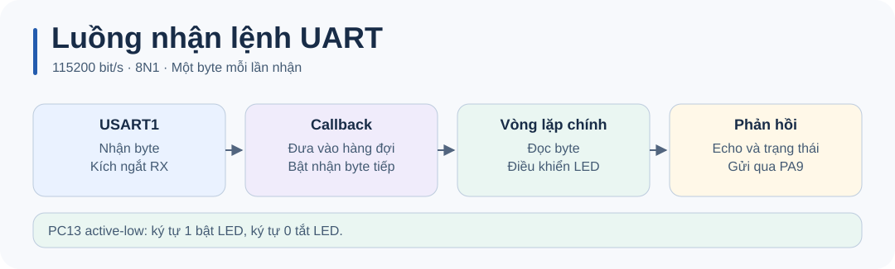

# STM32 UART · Hướng dẫn kỹ thuật

Xem [README](../README.md) để đấu dây, build và chạy thử.

## Cấu hình

Chọn STM32F103C8T6, HSE 8 MHz và PLL ×9. Bật USART1 Asynchronous trên PA9/PA10, đặt 115200 8N1, bật USART1 global interrupt và cấu hình PC13 output push-pull. Trong project do CubeMX sinh, `USART1_IRQHandler()` cần gọi `HAL_UART_IRQHandler(&huart1)`. Build độc lập đã cung cấp các hook này trong [board support](../firmware/board.c).

## Luồng hoạt động

1. `HAL_UART_Receive_IT()` đăng ký nhận một byte.
2. `HAL_UART_RxCpltCallback()` đưa byte vào hàng đợi vòng và đăng ký lần nhận tiếp theo.
3. Vòng lặp chính lấy byte ra, xử lý LED và gọi `HAL_UART_Transmit()` để echo hoặc gửi trạng thái. Callback lỗi đăng ký lại RX nếu HAL đã đưa RX về trạng thái sẵn sàng.

| Cách dùng HAL | Khi phù hợp |
| --- | --- |
| Polling | Truyền thông báo ngắn từ vòng lặp chính; đặt timeout để giới hạn thời gian chờ. |
| Interrupt | Nhận lệnh rời rạc trong khi CPU làm việc khác, như demo. |
| DMA | Thu luồng dữ liệu dài hoặc tốc độ cao, khi đã thiết kế bộ đệm và điểm kết thúc. |

## Kiểm tra và chẩn đoán

Theo dõi `debug_rx_count`, `debug_rx_dropped` và `debug_last_cmd`. Hàng đợi chứa tối đa 63 byte và bỏ byte mới khi đầy. Vì mỗi lệnh `1`/ `0` sinh phản hồi dài hơn một byte, demo phù hợp để nhập lệnh tương tác. Với giao thức theo dòng, ghép các byte trong main loop đến khi gặp LF và giới hạn chiều dài bộ đệm.

Không thấy phản hồi thì kiểm tra đúng cổng, dây TX/RX đấu chéo, GND chung và baud rate. Nếu mất dữ liệu khi gửi liên tục, xem `debug_rx_dropped` hoặc gửi lệnh với nhịp chậm hơn.
